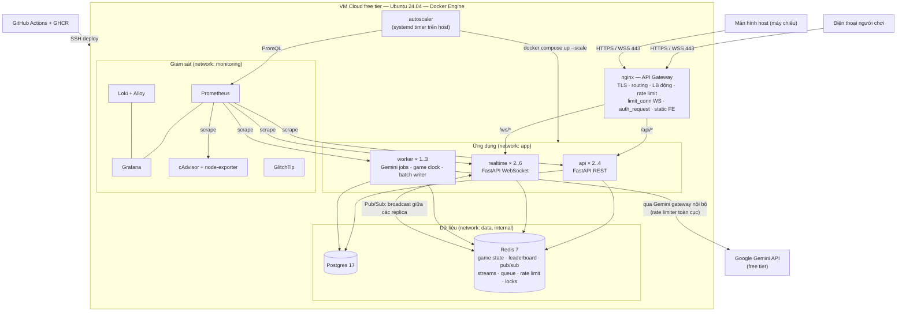
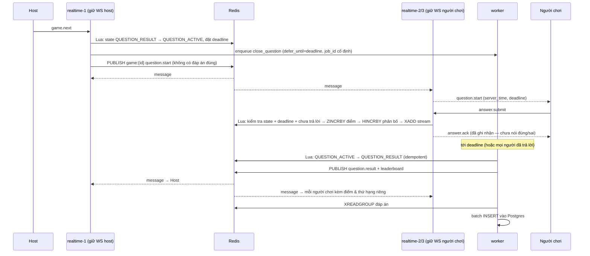
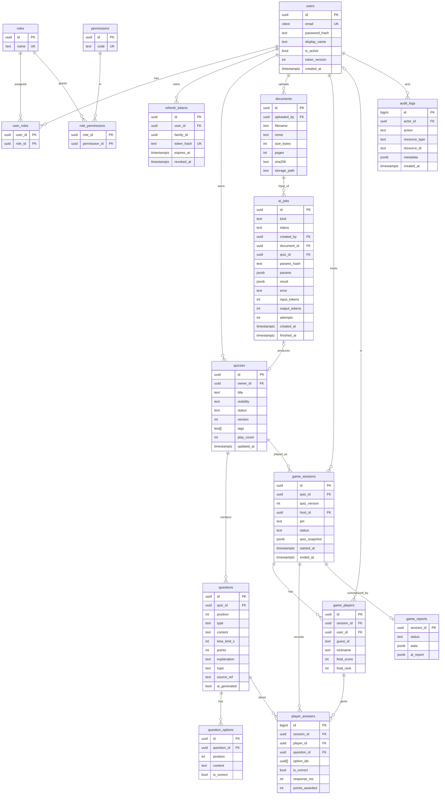

# ARCHITECTURE — QuizArena

> Tài liệu này mô tả **cách** hệ thống được tổ chức để đáp ứng SRS. Mọi sơ đồ phải khớp hệ thống đang chạy; khi code thay đổi, cập nhật tài liệu này trong cùng Pull Request.

## 1. Tổng quan

* QuizArena là **một codebase backend, ba điểm vào (entrypoint), ba service scale độc lập**, đứng sau một nginx đóng vai trò API gateway, dùng Postgres cho dữ liệu bền và Redis cho trạng thái trận đang chạy.



*Hình 1. Sơ đồ tổng thể.* Một origin duy nhất: `/` là frontend, `/api` là REST, `/ws` là WebSocket.

## 2. Vì sao tách `api`, `realtime`, `worker` dù chung codebase?

Ba service chạy cùng một mã nguồn và cùng một image Docker, chỉ khác lệnh khởi động, vì **ba loại tải của chúng khác hẳn nhau** nên cần được co giãn, cấu hình và hỏng độc lập. `api` xử lý các request REST ngắn, nên tải của nó tỉ lệ với số request và CPU. `realtime` giữ các kết nối WebSocket sống hàng giờ, nên tải của nó tỉ lệ với **số kết nối đang mở** chứ không phải số request, và nginx cũng phải cấu hình riêng cho nó (timeout đọc dài, giới hạn số kết nối). `worker` chạy các công việc dài hoặc theo lịch (gọi Gemini mất hàng chục giây, đóng câu hỏi đúng deadline, ghi đáp án vào Postgres theo lô), nên nếu để trong `api` hay `realtime` thì chúng chặn hoặc chết theo replica đó; đặc biệt đồng hồ trận nằm ở `worker` để một replica `realtime` bị tắt giữa câu không làm câu hỏi kẹt. Nhờ tách, ta scale `realtime` từ 2 lên 6 mà không phải nhân bản cả phần REST, triển khai lại `api` mà không cắt WebSocket, và một job Gemini bị chậm không ảnh hưởng người đang chơi. Cái giá phải trả là vận hành phức tạp hơn (nhiều service, phải có Redis Pub/Sub để các replica `realtime` nói chuyện với nhau).

|                       | `api`                                  | `realtime`                          | `worker`                                                |
| --------------------- | ---------------------------------------- | ------------------------------------- | --------------------------------------------------------- |
| Việc chính          | REST, đăng nhập, quiz, SSE tiến độ | WebSocket, broadcast, nhận đáp án | Job Gemini, đóng câu hỏi, ghi lô Postgres, báo cáo |
| Dạng tải            | Request ngắn                            | Kết nối dài                        | Công việc nền, có thể rất dài                      |
| Scale theo            | CPU / RPS                                | Số kết nối mỗi replica            | Độ dài hàng đợi                                     |
| Số replica dự kiến | 2–4                                     | 2–6                                  | 1–3                                                      |
| RAM ước tính       | 120–180 MB/replica                      | 100–200 MB/replica                   | 120–200 MB/replica                                       |
| Điểm vào           | `app/main_api.py`                      | `app/main_realtime.py`              | `app/worker.py`                                         |


## 3. Thành phần và trách nhiệm

| Thành phần             | Trách nhiệm                                                                                                                                    | Không làm                                                                    |
| ------------------------ | ------------------------------------------------------------------------------------------------------------------------------------------------ | ------------------------------------------------------------------------------ |
| **nginx**          | TLS, routing `/api` `/ws` `/`, cân bằng tải, rate limit, `limit_conn` cho WS, phục vụ frontend tĩnh, chặn `/metrics` từ ngoài | Không chứa logic nghiệp vụ                                                 |
| **api**            | Xác thực/phân quyền, CRUD quiz, nhận upload, tạo job AI, SSE tiến độ, REST cho trận/báo cáo/lịch sử/admin                          | Không giữ kết nối WS; không gọi Gemini trực tiếp                       |
| **realtime**       | Nhận kết nối WS, đổi vé lấy danh tính, nhận lệnh/đáp án, phát thông điệp qua Redis Pub/Sub                                      | Không giữ đồng hồ trận; không là nguồn dữ liệu duy nhất của trận |
| **worker**         | `generate_quiz`, `close_question`, `persist_answers`, `game_report`; là nơi duy nhất gọi Gemini                                      | Không phục vụ request từ client                                            |
| **Postgres**       | Dữ liệu bền: người dùng, quiz, trận, đáp án, báo cáo, audit                                                                          | Không nằm trên đường nóng của từng đáp án trong trận              |
| **Redis**          | Trạng thái trận, leaderboard, Pub/Sub, Stream write-behind, hàng đợi job, rate limit, khóa, denylist, ticket                              | Không phải nơi lưu vĩnh viễn                                             |
| **Gemini gateway** | Cổng nội bộ duy nhất tới Gemini: rate limiter toàn cục, retry theo `retryDelay`, timeout, ghi token usage                               | Không để thành phần khác gọi thẳng API                                 |
| **autoscaler**     | Đọc Prometheus, tăng/giảm số replica theo kết nối, CPU, độ dài hàng đợi                                                             | —                                                                             |
| **Giám sát**     | Prometheus, Grafana, Loki + Alloy, cAdvisor, node-exporter, GlitchTip                                                                            | —                                                                             |

## 4. Mạng Docker và cổng

| Network        | Chứa                                                                | Ghi chú                                              |
| -------------- | -------------------------------------------------------------------- | ----------------------------------------------------- |
| `edge`       | nginx                                                                | Mạng duy nhất publish cổng ra Internet (22/80/443) |
| `app`        | nginx, api, realtime, worker                                         | Các service ứng dụng gọi nhau và nginx gọi vào |
| `data`       | api, realtime, worker, postgres, redis                               | `internal: true`, không có đường ra Internet   |
| `monitoring` | Prometheus, Grafana, Loki, Alloy, cAdvisor, node-exporter, GlitchTip | Tách khỏi dữ liệu ứng dụng                      |

Postgres và Redis **không** publish cổng ra host. Chỉ nginx publish 80/443 (và 22 cho SSH ở mức VM). `GET /metrics` chỉ truy cập được từ mạng nội bộ.

## 5. Luồng quan trọng

### 5.1. Một câu hỏi từ lúc bắt đầu đến lúc có kết quả (3 replica `realtime`)



*Hình 2. Vòng đời một câu hỏi.* Các điểm cần hiểu rõ khi vấn đáp:

- **Không có đáp án đúng trong `question.start`** (FR-GAME-08), và `answer.ack` chỉ báo "đã ghi nhận", không nói đúng hay sai.
- **Bước chấm điểm là một Lua script** để kiểm tra trạng thái, hạn chót, trùng lặp, cộng điểm và ghi Stream diễn ra nguyên tử (FR-GAME-13).
- **Việc đóng câu do worker làm** theo job hẹn giờ có `job_id` cố định, nên idempotent và không chết theo replica nào (FR-GAME-15).
- **Pub/Sub** là cách mọi replica `realtime` nhận cùng một sự kiện để chuyển cho người chơi mà mình đang giữ.

### 5.2. Sinh quiz bằng AI

```
Host ─POST /ai/quiz-generations (multipart PDF)→ api ─(kiểm tra magic bytes, sha256, quota host)→ cache hit? → trả luôn
                                                    └→ tạo ai_job (queued) → enqueue → 202 {job_id}
Host ─GET /ai-jobs/{id}/events (SSE)→ api ←(Redis pub/sub tiến độ)← worker
worker → Gemini gateway (đợi token từ rate limiter toàn cục) → Gemini (PDF + prompt + response_schema)
       → validate schema → validate nghiệp vụ → (retry 1 lần nếu kém) → lưu quiz draft → event succeeded
```

### 5.3. Refresh token rotation và reuse detection

Mỗi lần làm mới, cấp refresh token mới và vô hiệu token cũ (cùng `family_id`). Nếu một token **đã bị xoay** bị gửi lại thì thu hồi cả family và trả 401 (FR-AUTH-04, FR-AUTH-05). Frontend phải làm mới theo kiểu **single-flight**: 10 request cùng nhận 401 chỉ được gọi refresh một lần, nếu không sẽ tự kích hoạt reuse detection. Sequence diagram chi tiết bổ sung ở SRS mục 7.

## 6. Cấu trúc mã nguồn

```
backend/app/
  core/          cấu hình (pydantic-settings), bảo mật, log, redis, db
  middleware/    request-id, log JSON, CORS, metrics, xử lý lỗi
  api/v1/        auth, users, quizzes, ai, games, history, admin, realtime_ticket
  realtime/      endpoint WS, connection manager, cầu nối pub/sub, schema giao thức
  game/          máy trạng thái, chiến lược tính điểm, lua/*.lua, đồng hồ trận
  ai/            gemini_gateway, rate_limiter, prompts/, schema (QuizDraft, GameReport), fake
  models/  schemas/  repositories/  services/
  workers/       generate_quiz, close_question, persist_answers, game_report
  main_api.py  main_realtime.py  worker.py  cli.py
```

Luồng gọi một chiều: `api / realtime / workers` → `services` → `repositories` → `models`. Quy tắc phân quyền theo sở hữu kiểm tra ở tầng `services`.

**Mẫu thiết kế dự kiến** (câu vấn đáp #14: chỉ ra 3 mẫu và nếu không dùng thì code ra sao):

| Mẫu               | Dùng ở đâu                                                                         | Lợi ích                                                            |
| ------------------ | -------------------------------------------------------------------------------------- | -------------------------------------------------------------------- |
| State              | Trạng thái trận (`LOBBY`, `QUESTION_ACTIVE`, `QUESTION_RESULT`, `FINISHED`) | Chuyển trạng thái hợp lệ nằm một chỗ, từ chối chuyển sai  |
| Strategy           | Cách tính điểm                                                                     | Đổi luật tính điểm mà không sửa engine                      |
| Adapter            | Gemini gateway                                                                         | Đổi nhà cung cấp AI hoặc dùng bản giả (`fake.py`) khi test |
| Observer (Pub/Sub) | Broadcast giữa các replica `realtime`                                              | Replica không cần biết nhau                                       |
| Command            | Thông điệp WS của host và người chơi                                           | Mỗi lệnh là một đối tượng được xác thực rồi thực thi  |

## 7. Thiết kế dữ liệu bền (Postgres)

### 7.1. ERD



*Hình 3. ERD.* So với sơ đồ gốc của đề, bản này **bổ sung 4 bảng phân quyền** (`roles`, `permissions`, `user_roles`, `role_permissions`) và **hai cột** `ai_jobs.quiz_id` (để thể hiện quan hệ "job tạo ra quiz") và `ai_jobs.params_hash` (để tra cache theo FR-AIGEN-10).

### 7.2. Ràng buộc

| Bảng                | Ràng buộc                                                                                                                                                       | Mục đích                                                                        |
| -------------------- | ----------------------------------------------------------------------------------------------------------------------------------------------------------------- | ---------------------------------------------------------------------------------- |
| `player_answers`   | **`UNIQUE(session_id, player_id, question_id)`**                                                                                                          | Lớp bảo vệ cuối cho FR-GAME-09 khi ghi theo lô                                |
| `game_players`     | **`UNIQUE(session_id, nickname)`**                                                                                                                        | Nickname duy nhất trong trận (FR-GAME-04)                                        |
| `game_players`     | `CHECK` đúng một trong `user_id`, `guest_id` khác NULL; `UNIQUE(session_id, user_id)` khi `user_id` không NULL                                     | Phân biệt người có tài khoản và khách; một người một chỗ trong trận |
| `users`            | `email` kiểu `citext` + `UNIQUE`                                                                                                                           | Không phân biệt hoa thường (FR-AUTH-01)                                       |
| `refresh_tokens`   | `token_hash UNIQUE`; chỉ lưu SHA-256                                                                                                                          | FR-AUTH-04                                                                         |
| `quizzes`          | `CHECK visibility IN ('private','unlisted','public')`; `CHECK status IN ('draft','published','archived')`                                                     | Giá trị enum hợp lệ                                                            |
| `questions`        | `CHECK type IN ('single','multiple','true_false')`; `CHECK time_limit_s BETWEEN 5 AND 60`; `CHECK points IN (500,1000,2000)`; `UNIQUE(quiz_id, position)` | FR-QUIZ-02, FR-QUIZ-03                                                             |
| `question_options` | `UNIQUE(question_id, position)`                                                                                                                                 | Thứ tự lựa chọn                                                                |
| `ai_jobs`          | `CHECK status IN ('queued','running','succeeded','failed')`; `CHECK kind IN ('generate_quiz','regenerate_question','game_report')`                            | Trạng thái và loại job                                                         |
| `game_sessions`    | `CHECK status IN ('LOBBY','QUESTION_ACTIVE','QUESTION_RESULT','FINISHED')`; `UNIQUE(pin)` khi `ended_at IS NULL` (index riêng phần)                       | PIN duy nhất trong các trận đang mở (lớp thứ hai sau Redis)                 |
| `game_reports`     | `CHECK status IN ('pending','ready','degraded')`                                                                                                                | FR-AIRPT-06                                                                        |

**Quy tắc `ON DELETE` (đề xuất):**

| Quan hệ                                                                    | Hành vi           | Lý do                                                           |
| --------------------------------------------------------------------------- | ------------------ | ---------------------------------------------------------------- |
| `users` → `refresh_tokens`, `user_roles`                             | CASCADE            | Xóa user thì xóa token và gán quyền                        |
| `quizzes` → `questions` → `question_options`                        | CASCADE            | Quiz là một khối                                              |
| `quizzes` → `game_sessions`                                            | **RESTRICT** | Quiz đã có trận không được xóa cứng, chỉ `archived` |
| `users` → `quizzes`, `game_sessions` (host)                          | RESTRICT           | Không để dữ liệu mồ côi                                   |
| `users` → `game_players.user_id`, `audit_logs.actor_id`              | SET NULL           | Giữ lại lịch sử khi tài khoản bị xóa                     |
| `game_sessions` → `game_players`, `player_answers`, `game_reports` | CASCADE            | Dữ liệu thuộc trận                                           |

### 7.3. Chỉ mục (index)

| Bảng              | Index                                                                                                                                            | Phục vụ                                     |
| ------------------ | ------------------------------------------------------------------------------------------------------------------------------------------------ | --------------------------------------------- |
| `quizzes`        | `(owner_id, updated_at DESC)`                                                                                                                  | Danh sách quiz của host                     |
| `quizzes`        | Một phần: `(play_count DESC)` với `visibility='public' AND status='published'`; GIN trên `tags`; tìm tiêu đề (ví dụ `pg_trgm`) | Danh sách quiz public (FR-QUIZ-07)           |
| `documents`      | `(sha256)`                                                                                                                                     | Tra cache tài liệu                          |
| `ai_jobs`        | `(created_by, created_at DESC)`, `(document_id, params_hash)`                                                                                | Hạn mức mỗi ngày, cache (FR-AIGEN-10, 13) |
| `game_sessions`  | `(host_id, started_at DESC)`                                                                                                                   | Lịch sử host                                |
| `game_players`   | `(user_id, session_id)`                                                                                                                        | Lịch sử player                              |
| `player_answers` | `(session_id, question_id)`                                                                                                                    | Thống kê tỉ lệ đúng từng câu          |
| `refresh_tokens` | `(user_id)`, `(family_id)`                                                                                                                   | Thu hồi cả family                           |
| `audit_logs`     | `(actor_id, created_at DESC)`, `(resource_type, resource_id)`                                                                                | Tra cứu kiểm toán                          |

`quiz_snapshot` (JSONB) giữ nội dung quiz tại lúc mở trận, nên báo cáo của trận cũ không bị ảnh hưởng khi quiz bị sửa (FR-QUIZ-06, FR-GAME-02).

## 8. Dữ liệu trong Redis

| Key                                                       | Kiểu         | TTL                        | Mục đích                                                         |
| --------------------------------------------------------- | ------------- | -------------------------- | ------------------------------------------------------------------- |
| `pin:{pin}` → `game_id`                              | String        | 3 h                        | Tra PIN                                                             |
| `game:{id}:state`                                       | Hash          | 3 h                        | `status`, `q_index`, `deadline`, `started_at`…             |
| `game:{id}:quiz`                                        | String (JSON) | 3 h                        | Snapshot nội dung quiz, **có đáp án, chỉ server đọc** |
| `game:{id}:players`                                     | Hash          | 3 h                        | player_id → nickname, online, streak                               |
| `game:{id}:lb`                                          | ZSET          | 3 h                        | Leaderboard                                                         |
| `game:{id}:q:{n}:answered`                              | Set           | 3 h                        | Chống trả lời 2 lần                                             |
| `game:{id}:q:{n}:dist`                                  | Hash          | 3 h                        | Phân bố lựa chọn                                                |
| `game:{id}:answers`                                     | Stream        | Đến khi đối soát xong | Write-behind sang Postgres                                          |
| channel `game:{id}`                                     | Pub/Sub       | —                         | Broadcast giữa các replica `realtime`                           |
| `ws:ticket:{token}`                                     | String        | 30 s                       | Vé WS dùng một lần                                              |
| `rl:*`, `deny:jti:*`, `login_fail:*`                | —            | —                         | Rate limit, denylist, chống dò mật khẩu                         |
| `gemini:rpm:{model}`, `gemini:rpd:{model}:{yyyymmdd}` | —            | —                         | Rate limiter Gemini toàn cục                                      |
| `cache:*`                                               | String        | 30–300 s                  | Cache-aside (quiz public, dashboard)                                |
| `lock:*`                                                | String        | Ngắn                      | Khóa phân tán                                                    |

## 9. Danh sách API (tiền tố `/api/v1`)

Cột "FR" liên kết với `docs/SRS.md`. Dấu ✱ là endpoint **bổ sung ngoài bảng §6.3 của đề** để đủ cho yêu cầu trong SRS (cần xác nhận với mentor).

| Nhóm       | Method & Path                                                            | Quyền                                    | FR                             | Ghi chú                                                                       |
| ----------- | ------------------------------------------------------------------------ | ----------------------------------------- | ------------------------------ | ------------------------------------------------------------------------------ |
| Auth        | `POST /auth/register`                                                  | public                                    | FR-AUTH-01                     |                                                                                |
|             | `POST /auth/login`                                                     | public                                    | FR-AUTH-02, 03, 08             | Access token trong body, refresh token trong cookie                            |
|             | `POST /auth/refresh`                                                   | cookie refresh                            | FR-AUTH-04, 05                 | Xoay vòng + phát hiện dùng lại                                            |
|             | `POST /auth/logout`                                                    | đã đăng nhập                         | FR-AUTH-06                     | Denylist `jti`                                                               |
|             | `POST /auth/logout-all`                                                | đã đăng nhập                         | FR-AUTH-07                     | Tăng `token_version`                                                        |
|             | `POST /auth/change-password`                                           | đã đăng nhập                         | FR-AUTH-07                     |                                                                                |
|             | `GET /auth/me`                                                         | đã đăng nhập                         | —                             | Thông tin tài khoản                                                         |
| Join        | `POST /games/join` `{pin, nickname}`                                 | public hoặc đã đăng nhập            | FR-AUTH-09, 10; FR-GAME-04, 20 | Trả guest token hoặc gắn tài khoản; rate limit theo IP                    |
| Realtime    | `POST /realtime/ws-ticket`                                             | `game:play` / `game:host_own`         | FR-AUTH-11                     | Vé TTL 30 s, dùng một lần                                                  |
|             | `WS /ws/game?ticket=…`                                                | theo vé                                  | FR-GAME-03…22                 | Xem `WS_PROTOCOL.md`                                                         |
| Quiz        | `POST /quizzes`                                                        | `quiz:write_own`                        | FR-QUIZ-01                     |                                                                                |
|             | `GET /quizzes`                                                         | `quiz:write_own` / `quiz:read_public` | FR-QUIZ-07                     | Tham số: phạm vi (của tôi / public), `q`, `tag`, `sort`, phân trang |
|             | `GET /quizzes/{id}`, `PATCH /quizzes/{id}`, `DELETE /quizzes/{id}` | `quiz:*` + sở hữu                     | FR-QUIZ-01, 06; FR-AUTHZ-03    | Sửa quiz đã có trận sinh phiên bản mới                                 |
|             | `POST /quizzes/{id}/publish`                                           | `quiz:write_own` + sở hữu             | FR-QUIZ-05                     |                                                                                |
|             | `POST /quizzes/{id}/clone`                                             | `quiz:write_own`                        | FR-QUIZ-08                     |                                                                                |
| Câu hỏi   | `POST /quizzes/{id}/questions`                                         | `quiz:write_own` + sở hữu             | FR-QUIZ-02, 03                 |                                                                                |
|             | `PATCH/DELETE /quizzes/{id}/questions/{qid}`                           | `quiz:write_own` + sở hữu             | FR-QUIZ-02, 03; FR-AIGEN-08    |                                                                                |
|             | `PUT /quizzes/{id}/questions/order`                                    | `quiz:write_own` + sở hữu             | FR-QUIZ-04                     |                                                                                |
| AI          | `POST /ai/quiz-generations` (multipart)                                | `quiz:ai_generate`                      | FR-AIGEN-01…04, 10, 12, 13    | `202` + `job_id`                                                           |
|             | `GET /ai-jobs/{id}`                                                    | chủ job                                  | FR-AIGEN-03                    |                                                                                |
|             | `GET /ai-jobs/{id}/events` (SSE)                                       | chủ job                                  | FR-AIGEN-03                    | `queued → running → succeeded/failed`                                      |
|             | `POST /quizzes/{id}/questions/{qid}/regenerate`                        | `quiz:ai_generate`                      | FR-AIGEN-09                    | Kèm lý do                                                                    |
| Game (host) | `POST /games` `{quiz_id}`                                            | `game:host_own`                         | FR-GAME-01, 02, 20             | Trả PIN                                                                       |
|             | `GET /games` ✱                                                        | `game:host_own`                         | FR-HIST-02                     | Danh sách trận của host                                                     |
|             | `GET /games/{id}`                                                      | `game:host_own` + sở hữu              | FR-HIST-02                     | Chi tiết, tỉ lệ đúng từng câu                                           |
|             | `POST /games/{id}/end`                                                 | `game:host_own` + sở hữu              | FR-GAME-14; FR-ADM-05          | Điều khiển còn lại qua WS                                                 |
|             | `GET /games/{id}/export.csv` ✱                                        | `game:host_own` + sở hữu              | FR-HIST-04                     | Mức Could                                                                     |
| Báo cáo   | `GET /games/{id}/report`                                               | host của trận                           | FR-AIRPT-04, 07                |                                                                                |
|             | `POST /games/{id}/report/retry`                                        | host của trận                           | FR-AIRPT-06                    | Thử lại khi `degraded`                                                     |
| Lịch sử   | `GET /me/games`                                                        | `history:read_own`                      | FR-HIST-01                     | Phân trang                                                                    |
|             | `GET /me/games/{id}`                                                   | `history:read_own`                      | FR-HIST-01; FR-AIRPT-05, 07    | Kèm nhận xét AI cá nhân                                                   |
| Admin       | `GET /admin/users`, `PATCH /admin/users/{id}`                        | `users:manage`                          | FR-ADM-01                      | Khóa/mở khóa; audit log                                                     |
|             | `PUT /admin/users/{id}/roles`                                          | `users:manage`                          | FR-ADM-02, 05; FR-AUTHZ-05     |                                                                                |
|             | `POST /admin/quizzes/{id}/hide`                                        | `quiz:moderate`                         | FR-ADM-03, 05                  | Bắt buộc có lý do                                                          |
|             | `GET /admin/stats`                                                     | `system:read`                           | FR-ADM-04                      | Cache 30–60 s                                                                 |
|             | `GET /admin/gemini-usage`                                              | `system:read`                           | FR-ADM-04                      |                                                                                |
| Health      | `GET /healthz`, `GET /readyz`                                        | public                                    | —                             | `readyz` kiểm tra Postgres + Redis                                          |
| Metrics     | `GET /metrics`                                                         | chỉ mạng nội bộ                       | —                             | nginx chặn từ ngoài                                                         |

**Chuẩn lỗi thống nhất:**

```json
{"error": {"code": "GAME_NOT_FOUND", "message": "...", "request_id": "..."}}
```
