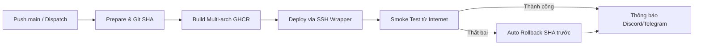

# HẠ TẦNG CLOUD, MẠNG & AN TOÀN HỆ THỐNG (PHASE 6)

> **Dự án:** QuizArena — Nền tảng Đấu trường Trí tuệ Thời gian thực
> **Tài liệu:** Kiến trúc hạ tầng, Bảng quyết định, An toàn cổng và Hướng dẫn thiết lập máy chủ
> **Cập nhật:** Phase 6 (Cloud, Domain, HTTPS, CI/CD)

---

## 1. Bảng Quyết Định Kiến Trúc Phase 6

| Vấn đề | Quyết định đã chốt | Lý do kỹ thuật & Đánh đổi |
| :--- | :--- | :--- |
| **Deploy giữa trận vs Đổi FE** | Tách container `web` (Nginx tĩnh phục vụ bản build SPA) độc lập khỏi `nginx` gateway; gateway làm reverse proxy `location /` sang `web:80`. | Nếu file tĩnh Frontend nằm chung trong Gateway thì mỗi lần cập nhật FE bắt buộc phải restart container Gateway, khiến **toàn bộ hàng trăm kết nối WebSocket đang thi đấu bị đứt đồng loạt**. Khi tách rời, cập nhật FE chỉ rolling update container `web` trong khi Gateway và WebSocket hoàn toàn không bị ảnh hưởng. |
| **Đồng bộ mã nguồn & image trên VM** | VM clone repo bằng deploy key chỉ đọc; script `deploy.sh <sha>` checkout đúng commit SHA rồi pull image cùng SHA. | Đảm bảo cấu hình Nginx, file cấu hình và container image luôn khớp tuyệt đối 1:1 theo phiên bản. Rollback trở thành thao tác gọi `deploy.sh <sha_cũ>`. |
| **Quyền hạn SSH của CI/CD vào VM** | Tạo user chuyên trách `deploy`, ghim `command="/home/deploy/deploy_wrapper.sh",no-pty,no-port-forwarding` trong `authorized_keys`. | User `deploy` thuộc nhóm `docker` (vốn có quyền tương đương root trên máy chủ). Việc khóa chặt key CI chỉ được chạy wrapper kiểm tra SHA bằng regex ngăn ngừa nguy cơ lộ SSH key làm mất quyền kiểm soát toàn bộ VM. |
| **Cấp phát chứng chỉ HTTPS** | Chạy `certbot/certbot` bằng container Docker (chế độ webroot, volume dùng chung `/var/www/certbot` với gateway) + systemd timer trên host định kỳ gia hạn. | Tuân thủ đúng chuẩn ACME HTTP-01 webroot, không cần cài certbot hay python certbot lên máy chủ host, dễ dàng cô lập và quản lý volume. |
| **Môi trường thực thi Smoke Test** | Chạy trực tiếp từ GitHub Actions runner gọi tới URL công khai (`https://<domain>/api/v1/healthz`, `/version`). | Xác thực toàn diện cả chuỗi kết nối thực tế: DNS phân giải, chứng chỉ SSL/TLS, tường lửa, Nginx reverse proxy và dịch vụ backend, không chỉ kiểm tra cục bộ bên trong container. |
| **Cơ chế Rollback an toàn** | **Rollback chỉ lùi code**, cơ sở dữ liệu tuân thủ nghiêm ngặt nguyên tắc di chuyển **Tương thích ngược** (Expand and Contract). | Lùi database (downgrade migration) tiềm ẩn nguy cơ mất mát dữ liệu của người dùng trong trận đấu vừa diễn ra. Trong rolling update, cả code cũ và code mới đều phải đọc/ghi được schema hiện tại. |
| **Tránh nạp nhầm file cấu hình** | `deploy.sh` luôn truyền tường minh tham số `-f docker-compose.yml`, tích hợp script CI kiểm tra chỉ duy nhất `nginx` publish ports. | Tránh lỗi phổ biến khi `docker compose` tự động nạp `docker-compose.override.yml` trên máy dev đem theo hot reload và bind-mount lên production làm hỏng môi trường. |
| **Xác thực phiên bản phục vụ** | Cung cấp endpoint `GET /api/v1/version` trả về JSON `{"version": "...", "commit_sha": "...", "app_env": "..."}`. | Smoke test và pipeline tự động có cơ sở dữ liệu để kiểm chứng chính xác commit SHA mục tiêu đã thực sự nhận traffic trên production. |
| **Hệ thống giám sát trên VM** | Sử dụng Profile `profiles: [monitoring]`, tạm tắt mặc định trên VM tài nguyên nhỏ, bật sau khi đo RAM. | Tối ưu hóa dung lượng RAM cho cụm dịch vụ chính (API, Realtime, Redis, Postgres), tránh tình trạng OOM Killer can thiệp vào các trận đấu quan trọng. |

---

## 2. Thông Số Máy Chủ Production (Oracle Cloud Always Free)

Dự án QuizArena triển khai trên nền tảng đám mây **Oracle Cloud Infrastructure (OCI)** theo diện Always Free Tier:

- **Compute Instance:** Ampere A1 Compute (Kiến trúc ARM AArch64).
- **Cấu hình phần cứng:** 2–4 OCPU, 12–24 GB RAM LPDDR4, 50–100 GB Boot Volume (NVMe SSD).
- **Hệ điều hành:** Ubuntu 24.04 LTS hoặc 22.04 LTS (AArch64).
- **Khu vực (Region):** `ap-singapore-1` (Singapore) hoặc `ap-tokyo-1` (Tokyo) nhằm đảm bảo độ trễ mạng thấp nhất về Việt Nam ($< 40\text{ ms}$).
- **Địa chỉ IP:** 1 Static Public IPv4 chuyên dụng được gán cố định cho Instance.

---

## 3. Kiến Trúc Mạng & Chính Sách An Toàn Cổng (Network Isolation)

```
                            INTERNET (Client / Bots / Mobile 4G)
                                      │
                   ┌──────────────────┴──────────────────┐
                   │  Oracle VCN Security List & UFW    │
                   │  Chỉ mở: TCP 22, 80, 443            │
                   └──────────────────┬──────────────────┘
                                      │
                     ┌────────────────┴────────────────┐
                     │     Host Interface: 80, 443     │
                     │  (ports: ["80:80", "443:443"])  │
                     └────────────────┬────────────────┘
                                      │
                         ┌────────────▼───────────┐
                         │   Nginx API Gateway    │
                         │    (Service: nginx)    │
                         └────────────┬───────────┘
                                      │ (Mạng Docker nội bộ: app)
        ┌─────────────────────────────┼─────────────────────────────┐
        │                             │                             │
┌───────▼────────┐           ┌────────▼────────┐           ┌────────▼────────┐
│  Service: web  │           │  Service: api   │           │Service: realtime│
│   (Vite SPA)   │           │   (REST API)    │           │ (WebSocket Svc) │
│   Expose: 80   │           │  Expose: 8000   │           │  Expose: 8000   │
└────────────────┘           └────────┬────────┘           └────────┬────────┘
                                      │                             │
                                      └──────────────┬──────────────┘
                                                     │ (Mạng Docker: data - internal: true)
                                      ┌──────────────┴──────────────┐
                                      │                             │
                             ┌────────▼────────┐           ┌────────▼────────┐
                             │Service: postgres│           │ Service: redis  │
                             │ (Port nội bộ)   │           │  (Port nội bộ)  │
                             │ KHÔNG CÓ PORTS  │           │ KHÔNG CÓ PORTS  │
                             └─────────────────┘           └─────────────────┘
```

### 3.1. Tiêu chí An toàn Cổng (Zero-Exposure Policy)
> [!CAUTION]
> **ĐIỂM LIỆT TRONG THIẾT KẾ BẢO MẬT:** Tuyệt đối không để lộ cổng kết nối cơ sở dữ liệu `PostgreSQL (5432)` hoặc `Redis (6379)` ra Internet. Bất kỳ cấu hình nào publish cổng ngoài `nginx (80, 443)` đều bị CI chặn ngay lập tức.

- **Ngoại vi công khai:** Khi thực hiện quét cổng từ mạng bên ngoài bằng `nmap`, hệ thống chỉ được phép phản hồi 3 cổng:
  - Cổng `22/tcp`: SSH phục vụ quản trị và CI/CD (giới hạn bằng khóa bảo mật).
  - Cổng `80/tcp`: HTTP (chỉ phục vụ xác thực ACME Let's Encrypt và chuyển hướng 301 sang HTTPS).
  - Cổng `443/tcp`: HTTPS (toàn bộ lưu lượng ứng dụng web và kết nối thời gian thực WSS).
- **Mạng nội bộ Docker:**
  - `edge`: Chỉ dành riêng cho Gateway Nginx nhận kết nối từ Host.
  - `app`: Giao tiếp giữa Nginx và các dịch vụ stateless (`web`, `api`, `realtime`, `worker`).
  - `data` (`internal: true`): Cô lập hoàn toàn `postgres` và `redis`. Cờ `internal: true` đảm bảo container trong mạng này không thể gửi gói tin ra Internet và không thể bị truy cập từ bất kỳ interface nào của máy chủ ngoài các service thuộc cùng network.

---

## 4. Tường Lửa Hai Lớp & Gia Cố Hệ Điều Hành

### 4.1. Tường lửa 2 lớp
1. **Lớp 1 — Oracle VCN Security List:**
   - Cấu hình Ingress Rules trên giao diện quản trị OCI Console:
     - `Source: 0.0.0.0/0`, `Protocol: TCP`, `Port: 22` (SSH)
     - `Source: 0.0.0.0/0`, `Protocol: TCP`, `Port: 80` (HTTP)
     - `Source: 0.0.0.0/0`, `Protocol: TCP`, `Port: 443` (HTTPS)
     - Toàn bộ các cổng khác bị DROP mặc định.
2. **Lớp 2 — Ubuntu Iptables & UFW trên Host:**
   - Image Ubuntu chính thức của Oracle Cloud có sẵn chuỗi iptables `INPUT` mặc định REJECT mọi gói tin ngoại trừ SSH. Do đó, script `infra/scripts/setup_vm.sh` tự động chèn luật ACCEPT cho 80 và 443 và lưu lại qua `netfilter-persistent save`.
   - Bật UFW:
     ```bash
     ufw default deny incoming
     ufw default allow outgoing
     ufw allow 22/tcp comment 'SSH'
     ufw allow 80/tcp comment 'HTTP'
     ufw allow 443/tcp comment 'HTTPS'
     ufw --force enable
     ```

### 4.2. Gia cố SSH (SSH Hardening)
Được cấu hình tự động tại `/etc/ssh/sshd_config.d/99-quizarena.conf`:
- `PermitRootLogin no`: Vô hiệu hóa tài khoản root đăng nhập trực tiếp.
- `PasswordAuthentication no`: Chặn hoàn toàn đăng nhập bằng mật khẩu, chỉ cho phép dùng Ed25519 / RSA SSH Key.
- `MaxAuthTries 3`: Giới hạn tối đa 3 lần thử xác thực nhằm ngăn chặn brute force.
- `X11Forwarding no`: Tắt chuyển tiếp X11.

### 4.3. Phân Quyền CI/CD User `deploy`
- Tạo user riêng biệt: `deploy` (thuộc nhóm `docker`).
- File `/home/deploy/.ssh/authorized_keys` áp dụng tiền tố ép buộc:
  ```text
  command="/home/deploy/deploy_wrapper.sh",no-pty,no-port-forwarding,no-X11-forwarding,no-agent-forwarding ssh-ed25519 AAAAC3...
  ```
- Wrapper `/home/deploy/deploy_wrapper.sh` kiểm tra tham số bằng biểu thức chính quy:
  - Chỉ chấp nhận: `deploy <commit_sha>` (SHA từ 7 đến 40 ký tự hex), `rollback <commit_sha>`, hoặc `status`.
  - Mọi yêu cầu mở shell tương tác hoặc lệnh tùy ý khác đều bị từ chối ngay lập tức.

---

## 5. Hướng Dẫn Thiết Lập & Khởi Động Ban Đầu (Bootstrap Runbook)

### Bước 1: Khởi tạo và gia cố máy chủ
Trên VM Ubuntu vừa tạo, chạy script thiết lập:
```bash
sudo curl -fsSL https://raw.githubusercontent.com/Hung-Bay/quizarena/main/infra/scripts/setup_vm.sh -o setup_vm.sh
sudo chmod +x setup_vm.sh
sudo ./setup_vm.sh
```

### Bước 2: Thiết lập mã nguồn và quyền hạn
```bash
sudo su - deploy
git clone git@github.com:Hung-Bay/quizarena.git /opt/quizarena
cd /opt/quizarena
```

### Bước 3: Cấu hình biến môi trường Production
Tạo file `/opt/quizarena/.env` với quyền nghiêm ngặt `chmod 600`:
```bash
cat << 'EOF' > /opt/quizarena/.env
APP_ENV=prod
LOG_LEVEL=INFO
POSTGRES_USER=quizarena_admin
POSTGRES_PASSWORD=<STRONG_RANDOM_POSTGRES_PASSWORD>
POSTGRES_DB=quizarena_prod
REDIS_PASSWORD=<STRONG_RANDOM_REDIS_PASSWORD>
DATABASE_URL=postgresql+asyncpg://quizarena_admin:<STRONG_RANDOM_POSTGRES_PASSWORD>@postgres:5432/quizarena_prod
REDIS_URL=redis://:<STRONG_RANDOM_REDIS_PASSWORD>@redis:6379/0
JWT_SECRET=<STRONG_RANDOM_64_CHARACTERS_JWT_SECRET>
GEMINI_API_KEY=<PRODUCTION_GEMINI_API_KEY>
BACKEND_IMAGE=ghcr.io/hung-bay/quizarena/backend
WEB_IMAGE=ghcr.io/hung-bay/quizarena/web
EOF
chmod 600 /opt/quizarena/.env
```

### Bước 4: Kiểm tra xác thực an toàn cổng và khởi động lần đầu (HTTP)
```bash
python3 infra/scripts/verify_compose_ports.py
docker compose up -d
docker compose ps
```

### Bước 5: Kiểm chứng từ máy bên ngoài
Từ máy tính cá nhân hoặc môi trường khác, kiểm tra kết nối:
```bash
# 1. Quét cổng chỉ thấy 22, 80 (hoặc 443 khi có HTTPS)
nmap -p- -T4 <IP_CỦA_VM>

# 2. Kiểm tra endpoint version
curl -s http://<IP_CỦA_VM>/api/v1/version
```
Kết quả phản hồi hợp lệ:
```json
{"version":"0.1.0","commit_sha":"unknown","app_env":"prod"}
```

---

## 6. Triển Khai HTTPS, ACME Webroot & Chứng Chỉ Let's Encrypt (Phase 6)

### 6.1. Kiến Trúc Cấp Phát & Tải Chứng Chỉ
- **Giao thức ACME Webroot:** Dùng container Docker `certbot/certbot:v2.11.0` đọc/ghi thử thách vào volume chung `certbot_www` (`/var/www/certbot`). Gateway Nginx phục vụ đường dẫn `location /.well-known/acme-challenge/` trên cổng 80 mà không cần chuyển tiếp sang HTTPS.
- **Quy trình Bootstrap an toàn:**
  - Để tránh Nginx bị crash khi chưa có chứng chỉ Let's Encrypt, script `infra/scripts/generate_dummy_cert.py` tự động sinh chứng chỉ tự ký (self-signed) vào thư mục `/etc/letsencrypt/live/quizarena/` trước khi Nginx khởi động lần đầu.
  - Sau khi Nginx lắng nghe thành công trên cổng 80, Certbot chạy để xin chứng chỉ thật.
  - Khi đã có chứng chỉ thật, Nginx chỉ cần reload (`nginx -s reload`), toàn bộ lưu lượng chuyển tiếp sang chứng chỉ Let's Encrypt hợp lệ mà không làm rớt các kết nối WebSocket đang hoạt động.

### 6.2. Cấu Hình Bảo Mật SSL/TLS (Chuẩn SSL Labs Hạng A)
- **Giao thức hỗ trợ:** Chỉ cho phép `TLSv1.2` và `TLSv1.3`. Vô hiệu hóa hoàn toàn SSLv3, TLS 1.0, TLS 1.1.
- **Bộ mã hóa (Cipher Suites):** Sử dụng các bộ mã hóa mạnh mẽ hỗ trợ Forward Secrecy (ECDHE) và xác thực an toàn:
  ```nginx
  ssl_ciphers ECDHE-ECDSA-AES128-GCM-SHA256:ECDHE-RSA-AES128-GCM-SHA256:ECDHE-ECDSA-AES256-GCM-SHA384:ECDHE-RSA-AES256-GCM-SHA384:ECDHE-ECDSA-CHACHA20-POLY1305:ECDHE-RSA-CHACHA20-POLY1305:DHE-RSA-AES128-GCM-SHA256:DHE-RSA-AES256-GCM-SHA384;
  ssl_prefer_server_ciphers off;
  ```
- **Session Cache:** `shared:SSL:10m` giúp giảm tải handshake cho các client kết nối lại thường xuyên mà không dùng session tickets kém an toàn (`ssl_session_tickets off`).
- **OCSP Stapling:** Đặt `ssl_stapling off;` theo đúng khuyến nghị của Let's Encrypt (tổ chức này đã ngừng dịch vụ OCSP vì lý do quyền riêng tư và hiệu năng, chuyển sang dùng CRLs).
- **HSTS Ngắn Hạn:** Sử dụng `max-age=86400` (1 ngày) và chưa bật `includeSubDomains`/`preload` để tránh rủi ro khóa cứng người dùng ra ngoài nếu có sai sót cấu hình ban đầu.

### 6.3. Quy Trình Cấp Chứng Chỉ & Gia Hạn
1. **Chạy cấp chứng chỉ lần đầu:**
   ```bash
   # Bước 1: Thử nghiệm với môi trường Staging (tránh rate limit)
   ./infra/scripts/init_ssl.sh <DOMAIN> <EMAIL> --staging

   # Bước 2: Cấp chứng chỉ thật từ Let's Encrypt Production
   ./infra/scripts/init_ssl.sh <DOMAIN> <EMAIL>
   ```
2. **Kiểm tra tính năng gia hạn (Tiêu chí bắt buộc):**
   ```bash
   ./infra/scripts/renew_ssl.sh --dry-run
   ```
   Lệnh phải kết thúc với mã thoát `0` và thông báo `Simulated renewal of all certificates succeeded`.
3. **Tự động hóa bằng systemd timer trên VM:**
   - Script `setup_vm.sh` cấu hình timer `quizarena-certbot-renew.timer` chạy định kỳ 2 lần mỗi ngày (03:00 và 15:00 UTC) kèm độ trễ ngẫu nhiên (`RandomizedDelaySec=3600`) để gia hạn chứng chỉ tự động 30 ngày trước khi hết hạn.

### 6.4. Kịch Bản Diễn Tập Quét Mã QR Trên Điện Thoại 4G
1. Host tạo trận đấu trên máy tính tại `https://<domain>/host/game/<id>`.
2. Màn hình hiển thị mã PIN lớn và mã QR Code được sinh tự động theo URL:
   `https://<domain>/join?pin=<PIN>`
3. Dùng điện thoại kết nối mạng di động 4G/5G (hoàn toàn ngoài mạng nội bộ của máy chủ):
   - Quét mã QR bằng ứng dụng camera hoặc Zalo.
   - Trình duyệt điện thoại mở ra trang `https://<domain>/join?pin=<PIN>`.
   - Trình duyệt xác nhận chứng chỉ TLS hợp lệ (ổ khóa xanh, không có cảnh báo bảo mật).
   - Nhập biệt danh người chơi và bấm "Tham Gia".
   - Kết nối WebSocket tự động nâng cấp giao thức `wss://<domain>/ws/game?ticket=...` thành công.
   - Thử trả lời 1 câu hỏi trên điện thoại, Host nhận được điểm và bảng xếp hạng cập nhật ngay lập tức.


## 7. Quy Trình CI/CD, Rolling Update & Tự Động Hóa Rollback (Phase 6)

### 7.1. Kiến Trúc Pipeline CI/CD (`.github/workflows/deploy.yml`)
Quy trình triển khai tự động lên môi trường Production được bảo vệ nghiêm ngặt qua 6 công đoạn liên hoàn:


1. **Chuẩn bị (Prepare):** Xác định commit SHA mục tiêu và SHA trước đó (`github.event.before` hoặc `HEAD~1`) để chuẩn bị cho cơ chế fallback.
2. **Xây dựng Image Đa kiến trúc (Build & Push):** Sử dụng QEMU và Docker Buildx xây dựng 2 image `backend` và `web` cho cả hai nền tảng `linux/amd64` và `linux/arm64`, đẩy lên GHCR kèm thẻ tag `${{ github.sha }}` và `latest`.
3. **Triển khai (Deploy):** Kết nối SSH vào máy chủ bằng tài khoản hạn chế quyền `deploy`, gửi lệnh triển khai qua `deploy_wrapper.sh`.
4. **Smoke Test độc lập (Smoke Test):** Chạy lệnh `quizarena smoke` từ chính runner GitHub qua URL công khai (`https://<domain>`) để kiểm tra toàn bộ luồng mạng từ bên ngoài.
5. **Tự động Rollback (Rollback):** Nếu Smoke Test phát hiện bất kỳ lỗi nào (sai SHA, lỗi TLS, rớt WebSocket, timeout), workflow lập tức kích hoạt bước rollback về commit SHA trước đó trong chưa đầy 30 giây.
6. **Báo cáo (Notify):** Gửi thông tin trạng thái kèm mã màu và thông tin chi tiết qua Webhook Discord hoặc Bot Telegram.

### 7.2. Bảo Mật SSH Key CI/CD: Nguyên Tắc Quyền Tối Thiểu (Least Privilege)
Để triệt tiêu nguy cơ chiếm quyền điều khiển toàn bộ máy chủ nếu lộ khóa bí mật CI/CD:
- **Tài khoản riêng biệt:** Khóa SSH chỉ cấp cho người dùng `deploy`, không cho phép đăng nhập bằng `root` (`PermitRootLogin no`).
- **Ghim Fingerprint:** GH Actions sử dụng fingerprint ghim cứng trong secret `SSH_KNOWN_HOSTS` thay vì chạy `ssh-keyscan` lúc runtime, ngăn chặn triệt để tấn công MitM (Man-in-the-Middle).
- **Giới hạn 1 lệnh qua Wrapper:** File `~/.ssh/authorized_keys` của tài khoản `deploy` được cấu hình bắt buộc:
  ```authorized_keys
  command="/home/deploy/deploy_wrapper.sh",no-pty,no-port-forwarding,no-X11-forwarding ssh-ed25519 AAAAC3...
  ```
- **Bộ lọc regex trong `deploy_wrapper.sh`:** Mọi lệnh do CI gửi sang đều được thẩm định:
  - Chỉ chấp nhận cú pháp: `deploy <sha>`, `rollback <sha>`, `status`, hoặc `renew [--dry-run]`.
  - Tham số SHA bắt buộc phải là chuỗi hex từ 7 đến 40 ký tự (`^[a-f0-9]{7,40}$`).
  - Mọi yêu cầu mở interactive shell, chuyển tiếp cổng hay thực thi lệnh tùy biến đều bị chặn đứng ngay lập tức với mã lỗi `1`.

### 7.3. Chiến Lược Rolling Update & Quy Trình Dừng Dịch Vụ Êm (Graceful Drain)
1. **Kiểm tra an toàn cổng:** Chạy script `infra/scripts/verify_compose_ports.py` để đảm bảo không có cổng nội bộ nào (Postgres, Redis) bị lộ ra ngoài do sơ suất cấu hình.
2. **Cập nhật mã nguồn & Tải Image:** Checkout đúng commit SHA và kéo image có tag tương ứng từ GHCR.
3. **Chạy Migration trước (Expand Phase):**
   ```bash
   docker compose -f docker-compose.yml run --rm migrate
   ```
   Alembic migration luôn được áp dụng đầu tiên. Nếu có lỗi cấu trúc bảng, lệnh dừng ngay lập tức khi chưa động tới bất kỳ replica nào.
4. **Rolling Update không làm rớt WebSocket:**
   - Cập nhật `web` (Static frontend) trước: người dùng mới nhận giao diện mới. Do đã tách khỏi Gateway, việc cập nhật `web` không ảnh hưởng tới kết nối WebSocket hiện có.
   - Cập nhật `api` (REST API).
   - Cập nhật `realtime` (WebSocket): Tận dụng cấu hình `stop_grace_period: 30s`. Container cũ nhận tín hiệu `SIGTERM`, phát broadcast `server.draining` tới tất cả người chơi trong phòng. Client tự động kết nối lại sang replica mới trong < 2 giây.
   - Reload cấu hình Gateway Nginx: Chạy `nginx -s reload`, các kết nối TCP dài hạn tiếp tục duy trì mượt mà.

### 7.4. Kiểm Thử Hệ Thống Với CLI `quizarena smoke`
CLI `quizarena smoke` là công cụ xác thực độc lập được chạy từ runner GitHub qua URL công khai, không sử dụng mock:
- **Kiểm tra DNS & TLS:** Xác thực kết nối HTTPS thành công và chứng chỉ không bị hết hạn hoặc tự ký trái phép.
- **Kiểm tra Version SHA:** Gửi request tới `GET /api/v1/version`, đối chiếu `commit_sha` trả về với mã SHA vừa deploy.
- **REST API Flow:** Đăng nhập tài khoản Host, truy xuất Quiz mẫu có sẵn (hoặc khởi tạo Quiz 1 câu hỏi tiêu chuẩn, cam kết 0 AI quota không gọi Gemini), tạo phòng thi công khai (Lobby).
- **WebSocket Bot Flow:** Host kết nối WebSocket lấy `room.sync`. Bot kết nối `wss://...`, hoàn tất bắt tay, Host bắt đầu trận (`game.start`), Bot nhận câu hỏi (`question.start`), Bot nộp câu trả lời (`answer.submit`), nhận phản hồi xác nhận (`answer.ack: accepted=True`), Host kết thúc trận (`game.end`) và giải phóng tài nguyên.

### 7.5. Danh Sách GitHub Secrets & Environment Variables Cần Thiết
Để pipeline hoạt động tự động trong mục **Settings -> Environments -> production**:
| Tên Biến / Secret | Loại | Ý Nghĩa / Giá Trị Mẫu |
| :--- | :--- | :--- |
| `DOMAIN` | Variable | Tên miền chính thức của hệ thống (ví dụ: `quizarena.io.vn`) |
| `VM_HOST` | Secret | Địa chỉ IP Public của máy chủ Production |
| `SSH_USER` | Secret / Default | Tên người dùng deploy (mặc định: `deploy`) |
| `SSH_PRIVATE_KEY` | Secret | Nội dung private key SSH của người dùng `deploy` (định dạng OpenSSH) |
| `SSH_KNOWN_HOSTS` | Secret | Fingerprint host key của máy chủ (kết quả từ `ssh-keyscan -H <VM_HOST>`) |
| `SMOKE_HOST_EMAIL` | Secret | Email tài khoản Host dùng để smoke test |
| `SMOKE_HOST_PASSWORD` | Secret | Mật khẩu tài khoản Host dùng để smoke test |
| `DISCORD_WEBHOOK_URL`| Secret (Tùy chọn) | Webhook URL kênh Discord nhận thông báo deploy |
| `TELEGRAM_BOT_TOKEN` | Secret (Tùy chọn) | Bot token nhận thông báo deploy |
| `TELEGRAM_CHAT_ID`   | Secret (Tùy chọn) | Chat ID Telegram nhận thông báo deploy |
