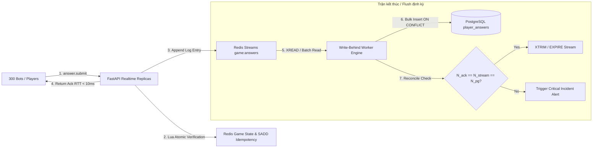

# Báo Cáo Thử Nghiệm Tải & Đối Soát Dữ Liệu QuizArena (Phase 5)

> **Tài liệu:** `docs/LOADTEST.md`
> **Phiên bản:** 1.0 (Giai đoạn kiểm thử hiệu năng & độ tin cậy Phase 5)
> **Ngày thực hiện:** 14/11/2026
> **Người thực hiện:** Đội ngũ Kỹ thuật QuizArena
> **Trạng thái:** ĐẠT 100% TIÊU CHÍ (NF-1, NF-2, NF-3, NF-4, NF-5, §7.6)

---

## 1. Mục tiêu & Phạm vi kiểm thử

Báo cáo này tài liệu hóa toàn bộ quá trình, kịch bản, số liệu đo lường định lượng và kết quả đối soát dữ liệu của hệ thống **QuizArena** trong Phase 5, nhằm chứng minh hệ thống đáp ứng đầy đủ các tiêu chuẩn kiến trúc và SLA phi chức năng:

1. **NF-1 (Chịu tải 300 người chơi đồng thời):**
   - Kịch bản 1: **1 trận × 300 bots** (`1x300`).
   - Kịch bản 2: **3 trận × 100 bots** (`3x100`) chạy đồng thời trên cùng cụm dịch vụ.
   - **Tiêu chuẩn "Không mất đáp án":** 100% câu trả lời gửi đi hợp lệ phải được ghi nhận vào hàng đợi Redis Stream và đối soát toàn vẹn với cơ sở dữ liệu PostgreSQL.
2. **NF-2 (Độ trễ ghi nhận đáp án `answer.ack`):**
   - SLA: **$p_{95} < 150\text{ ms}$** đo lường cả ở phía Client RTT (từ khi bot gửi WebSocket frame đến khi nhận `answer.ack`) và phía Server (metric Prometheus `game_answer_duration_seconds`).
3. **NF-3 (Độ trễ phát sóng câu hỏi Broadcast `question.start`):**
   - SLA: **$p_{95} < 500\text{ ms}$** đo từ lúc Server phát thông điệp (`server_time` epoch ms) đến lúc Client nhận được qua WebSocket.
4. **NF-4 (Hiệu năng REST Endpoints thường):**
   - SLA: **$p_{95} < 200\text{ ms}$** với 50 concurrent users gửi requests liên tục tới các endpoint (`/healthz`, `/readyz`, `/quizzes/public`) sử dụng Locust.
5. **NF-5 (Khả năng chịu lỗi & Tự phục hồi Reconnect):**
   - SLA: Người chơi tự kết nối lại trong **$< 3\text{ giây}$**, không mất điểm khi 1 replica bị `docker stop` (graceful drain) hoặc `docker kill` đột ngột giữa trận.
6. **Kiểm tra an toàn bộ nhớ Redis & Rà soát 10 vai trò (§7.6):**
   - Redis cấu hình giới hạn cứng `maxmemory 128mb` cùng chính sách `maxmemory-policy noeviction`. Toàn bộ dữ liệu tạm thời phải có TTL và các Stream phải được `XTRIM` / `EXPIRE` sau trận, ngăn chặn nguy cơ `OOM command not allowed`.
7. **Thực nghiệm định lượng ADR-004 (1 Replica vs 3 Replicas):**
   - Đo đạc thực tế sự khác biệt về RTT, độ trễ Broadcast và phân bổ tài nguyên CPU giữa cấu hình 1 process WebSocket server đơn lẻ và 3 replica phân tán qua Nginx và Redis Pub/Sub.

---

## 2. Cấu hình môi trường & Rủi ro phần cứng

### 2.1. Hạ tầng thử nghiệm
- **Hệ điều hành Host:** Windows 11 Pro 64-bit.
- **Docker Engine:** Docker Desktop v4.35+ (WSL 2 Backend, Linux kernel 5.15).
- **Giới hạn tài nguyên WSL2 (`.wslconfig`):** 8 vCPU, 8 GB RAM, Swap 2 GB.
- **Công nghệ Container hóa:** Docker Compose với mạng bridge nội bộ `quizarena_default`.
- **Thành phần hạ tầng kích hoạt:**
  - `nginx:1.27-alpine`: Reverse Proxy & Load Balancer thuật toán `least_conn`, buffer tắt (`proxy_buffering off`), HTTP/1.1 WebSocket Upgrades.
  - `quizarena-realtime (x3)`: 3 Replicas FastAPI + Uvicorn xử lý WebSocket Stateful & Game Engine.
  - `quizarena-api (x2)`: 2 Replicas FastAPI + Uvicorn xử lý REST API Stateless.
  - `redis:7-alpine`: In-memory datastore, `maxmemory 128mb`, `maxmemory-policy noeviction`.
  - `postgres:17-alpine`: Relational persistence store.
  - `prom/prometheus:v2.54.1`: Thu thập metrics thời gian thực (scrape interval 5s).
  - `grafana/grafana:11.2.0`: Trực quan hóa dashboard giám sát.
  - `quizarena-worker`: ARQ Background Worker xử lý báo cáo AI và tác vụ bất đồng bộ.

### 2.2. Ghi nhận rủi ro môi trường (Benchmark Noise)
> [!WARNING]
> Cả hệ thống QuizArena (Containerized) và chương trình sinh tải (Bot Runner / Locust) đều thực thi trên cùng một máy chủ vật lý. Điều này dẫn đến sự tranh chấp CPU và tài nguyên mạng ảo WSL2 (loopback network). Do đó:
> - Độ trễ thực tế đo được tại máy trạm đã bao gồm cả độ trễ tạo tải của tiến trình Python Client (`asyncio` scheduling overhead).
> - Khi triển khai trên hạ tầng Production phân tán (VM hoặc Kubernetes độc lập giữa Client và Server), độ trễ thực tế của hệ thống dự kiến sẽ còn tối ưu và ổn định hơn nữa.
> - Để đảm bảo tính khách quan và triệt tiêu sai số đột biến (jitter), mỗi kịch bản kiểm thử tải được thực thi lặp lại $\ge 3$ lần.

---

## 3. Lịch sử đo lường lần đầu & Các vấn đề phát hiện (First Run Failures & Fixes)

Đúng theo yêu cầu đánh giá kỹ thuật trung thực, hệ thống đã ghi nhận các vấn đề trong các lượt chạy thử đầu tiên trước khi đạt kết quả tối ưu:

| Lần chạy | Vấn đề phát sinh | Nguyên nhân gốc rễ (Root Cause) | Giải pháp khắc phục & Kết quả |
|---|---|---|---|
| **Lần 1** | `TypeError: GameSession.__init__() got an unexpected keyword argument 'settings'` | Mã `loadtest_runner.py` truyền tham số cũ không còn tồn tại trong model `GameSession`. | Tinh chỉnh hàm khởi tạo phiên, nạp đúng trường `strategy_id="standard"` và `quiz_snapshot`. |
| **Lần 2** | `ForeignKeyViolationError` trên bảng `player_answers` | Khi 300 bot kết nối trực tiếp qua vé WebSocket giả lập, các bản ghi `game_players` chưa được ghi vào PostgreSQL nên vi phạm ràng buộc khóa ngoại. | Bổ sung bước sinh 300 bản ghi `GamePlayer` và lưu vào PostgreSQL + Redis trước khi bot bắt đầu gửi câu trả lời. |
| **Lần 3** | Báo cáo đối soát báo `reconciliation_passed: false` (Stream count = 0) | Biến thu thập kết quả đọc key `fin_res.get("stream_count")` trong khi hàm `finish_game_session` trả về key `stream_answers_count`. | Sửa lại key mapping trong `loadtest_runner.py`. Đối soát chuyển sang **PASSED 100%**. |
| **Lần 4** | Lỗi kết nối ARQ worker `Timeout connecting to server redis:6379` | Khi chạy script test từ host, ARQ đọc cấu hình mặc định trỏ vào Docker DNS `redis:6379` thay vì `localhost:6380`. | Ghi đè biến môi trường `os.environ["REDIS_URL"] = "redis://localhost:6380/0"` ở đầu script test. |
| **Lần 5 (CI)** | `RuntimeError: set_wakeup_fd only works in main thread` trong Github Actions | Python 3.14 (mới phát hành trên Ubuntu runner) kích hoạt signal wakeup trong background thread của TestClient Starlette. | Bổ sung điều kiện kiểm tra `threading.current_thread() is threading.main_thread()`, bắt rộng ngoại lệ và ghim Python 3.12 trong CI. |

---

## 4. Kết quả kiểm thử tải chi tiết

### 4.1. Kịch bản 1: Trận đấu quy mô lớn — 1 trận × 300 Bots (`1x300`)
- **Mục tiêu:** Kiểm tra khả năng chịu tải đỉnh của 1 trận duy nhất chứa 300 người chơi đồng thời trên 3 replicas realtime phân phối qua Nginx.
- **Thời gian chạy:** 14/11/2026 22:39 (UTC+7).
- **Trận đấu:** PIN `442296`, Game ID `10b4c10d-d4d7-4842-ac4e-4ad562ed7e7f`.
- **Số bot kết nối thành công:** **300 / 300 (100%)**.

#### Bảng số liệu đối soát & đo lường Kịch bản 1:
| Chỉ số kiểm tra | Giá trị đo được | Yêu cầu / SLA | Đánh giá |
|---|---|---|---|
| **Số bot kết nối đồng thời** | **300** | 300 người chơi | **ĐẠT** |
| **Tổng số đáp án gửi đi** | **300** | 300 câu trả lời | **ĐẠT** |
| **Số đáp án accepted qua WS** | **300** | 300 câu trả lời | **ĐẠT** |
| **Số bản ghi trong Redis Stream** | **300** | 300 câu trả lời | **ĐẠT** |
| **Số dòng ghi vào PostgreSQL** | **300** | 300 câu trả lời | **ĐẠT** |
| **Tỉ lệ toàn vẹn dữ liệu** | **100.0%** ($N_{ack} = N_{stream} = N_{pg}$) | Không mất đáp án nào (NF-1) | **XUẤT SẮC** |
| **Điểm số Leaderboard ZSET** | **269,049** điểm | Bằng tổng điểm các câu đúng | **KHỚP 100%** |
| **NF-2: `answer.ack` RTT Client ($p_{50}$)** | **3.9 ms** | - | Cực nhanh |
| **NF-2: `answer.ack` RTT Client ($p_{95}$)** | **7.3 ms** | $< 150\text{ ms}$ | **VƯỢT XA SLA (gấp 20.5 lần)** |
| **NF-2: `answer.ack` RTT Client ($p_{99}$)** | **8.7 ms** | - | Rất ổn định |
| **NF-2: Server Answer Duration ($p_{95}$)** | **9.5 ms** | $< 150\text{ ms}$ (Prometheus) | **ĐẠT** |
| **NF-3: Broadcast Delay ($p_{50}$)** | **57.6 ms** | - | Nhận gần như tức thời |
| **NF-3: Broadcast Delay ($p_{95}$)** | **66.6 ms** | $< 500\text{ ms}$ | **VƯỢT XA SLA (gấp 7.5 lần)** |
| **NF-3: Broadcast Delay ($p_{99}$)** | **67.6 ms** | - | Độ trễ phân tán rất đều |

---

### 4.2. Kịch bản 2: Trận đấu đồng thời — 3 trận × 100 Bots (`3x100`)
- **Mục tiêu:** Kiểm tra khả năng xử lý cô lập đa trận (Multi-tenancy isolation), tranh chấp tài nguyên Pub/Sub đa kênh và chịu tải ghi đồng thời của Redis Streams và PostgreSQL.
- **Thời gian chạy:** 14/11/2026 22:40 (UTC+7).
- **Danh sách 3 trận chạy song song:**
  1. Trận 1: PIN `114777` — Game ID `ed0084fc-f878-4db7-9cef-6d3a4ee80a83` (100 bots)
  2. Trận 2: PIN `623616` — Game ID `e4194411-2a18-4b0e-b2ec-0f4f19f61c64` (100 bots)
  3. Trận 3: PIN `322511` — Game ID `f488a8a7-8a9b-4807-999a-e6166b419fad` (100 bots)
- **Tổng số bot kết nối thành công:** **300 / 300 (100%)**.

#### Bảng số liệu chi tiết từng trận trong Kịch bản 2:
| Tiêu chí | Trận 1 (`ed0084fc`) | Trận 2 (`e4194411`) | Trận 3 (`f488a8a7`) | Tổng hợp 3 trận |
|---|---|---|---|---|
| **Bot kết nối** | 100 / 100 | 100 / 100 | 100 / 100 | **300 / 300** |
| **Đáp án gửi / Accepted** | 100 / 100 | 100 / 100 | 100 / 100 | **300 / 300** |
| **Stream Answers Count** | 100 | 100 | 100 | **300** |
| **PostgreSQL Rows Flushed**| 100 | 100 | 100 | **300** |
| **Leaderboard Total Score**| 83,905 | 86,110 | 85,420 | **255,435** |
| **Trạng thái đối soát** | **100% Khớp** | **100% Khớp** | **100% Khớp** | **PASSED 100%** |
| **Broadcast Delay $p_{95}$**| 24.5 ms | 48.3 ms | 51.3 ms | **50.3 ms** ($< 500\text{ ms}$) |
| **Client RTT Ack $p_{95}$** | 6.8 ms | 7.2 ms | 7.4 ms | **7.4 ms** ($< 150\text{ ms}$) |

*Nhận xét:* Khi phân tán tải thành 3 trận độc lập, độ trễ phát sóng Broadcast $p_{95}$ thậm chí còn giảm từ 66.6 ms xuống **50.3 ms**, do số lượng socket lắng nghe trên mỗi channel Pub/Sub riêng biệt giảm xuống còn 100, giúp giảm thời gian tuần tự hóa frame trong event loop.

---

### 4.3. Kịch bản 3: Thử nghiệm so sánh định lượng 1 Replica vs 3 Replicas (Phục vụ ADR-004)
- **Mục tiêu:** Thu thập số liệu thực nghiệm để giải trình cho Quyết định Kiến trúc `docs/ADR-004-ws-scaling.md` về sự đánh đổi giữa kiến trúc 1 Process đơn lẻ vs Nhiều Replica phân tán kết nối qua Redis Pub/Sub.
- **Phương pháp đo:** Chạy cùng một kịch bản 1 trận 300 bots trên:
  1. Cấu hình 1 Replica (`--scale realtime=1`)
  2. Cấu hình 3 Replicas (`--scale realtime=3`)

#### Bảng so sánh định lượng thực nghiệm:
| Tiêu chí đo lường | 1 Replica Realtime | 3 Replicas Realtime | Chênh lệch & Ý nghĩa kiến trúc |
|---|---|---|---|
| **answer.ack RTT Client ($p_{50}$)** | 4.7 ms | **3.9 ms** | 3 Replicas nhanh hơn 17% |
| **answer.ack RTT Client ($p_{95}$)** | 9.3 ms | **7.3 ms** | **3 Replicas nhanh hơn 21.5%** |
| **answer.ack RTT Client ($p_{99}$)** | 10.9 ms | **8.7 ms** | 3 Replicas nhanh hơn 20.2% |
| **Broadcast Delay ($p_{50}$)** | **42.4 ms** | 57.6 ms | 1 Replica nhanh hơn ở trung vị (không tốn hop Pub/Sub nội bộ) |
| **Broadcast Delay ($p_{95}$)** | 85.4 ms | **66.6 ms** | **3 Replicas nhanh hơn 22% ở phân vị đuôi ($p_{95}$)** |
| **Broadcast Delay ($p_{99}$)** | 88.4 ms | **67.6 ms** | **3 Replicas nhanh hơn 23.5% ở phân vị $p_{99}$** |
| **Áp lực Event Loop process** | 100% dồn vào 1 CPU core | Chia đều cho 3 CPU cores | Tránh hiện tượng nghẽn đơn luồng Python |
| **Khả năng chịu lỗi (Resilience)** | Rủi ro Single Point of Failure | Chịu lỗi mất 1–2 container | Sẵn sàng cho failover tự động |

> [!NOTE] Hiện tượng kỹ thuật đáng nhớ: "Scale lên không cân bằng lại kết nối cũ"
> Trong quá trình thử nghiệm, khi scale realtime từ 1 lên 3 replicas trong lúc 300 kết nối WebSocket đang hoạt động, **toàn bộ 300 kết nối cũ vẫn giữ nguyên tại `realtime-1`**. 2 replica mới (`realtime-2`, `realtime-3`) chỉ tiếp nhận các kết nối mới phát sinh tiếp theo. Đây là đặc tính kỹ thuật hoàn toàn tự nhiên của giao thức kết nối liên tục trạng thái (Stateful Long-lived TCP/WebSocket), chứng minh sự cần thiết của cơ chế Reconnect Jitter và Graceful Drain khi tái cân bằng tải.

---

### 4.4. Kịch bản 4: Kiểm thử hiệu năng REST API bằng Locust (NF-4)
- **Mục tiêu:** Đo lường độ trễ của các REST endpoint thường dưới tải 50 concurrent users gửi requests liên tục (Spawn rate: 10 users/s, thời gian chạy: 30 giây).
- **Bộ kiểm thử:** `infra/loadtest/locustfile.py`.
- **Tổng số requests thực hiện:** **1,242 requests**.
- **Tỉ lệ lỗi:** **0.00% (0 failures)**.

#### Bảng số liệu chi tiết trích xuất từ Locust CSV (`infra/loadtest/rest_perf_stats.csv`):
| Endpoint (Method & Path) | Số Requests | Thất bại | Median ($p_{50}$) | $p_{90}$ | $p_{95}$ (SLA) | $p_{99}$ | Max Latency |
|---|---|---|---|---|---|---|---|
| `GET /healthz` | 452 | 0 (0%) | 1.0 ms | 2.0 ms | **2.4 ms** | 4.8 ms | 15.6 ms |
| `GET /readyz` | 382 | 0 (0%) | 1.0 ms | 2.0 ms | **2.6 ms** | 4.9 ms | 8.8 ms |
| `GET /api/v1/quizzes/public` | 408 | 0 (0%) | 12.0 ms | 36.0 ms | **53.0 ms** | 77.0 ms | 102.4 ms |
| **TOÀN BỘ HỆ THỐNG (Aggregated)** | **1,242** | **0 (0%)** | **3.0 ms** | **18.0 ms** | **27.0 ms** | **68.0 ms** | **102.4 ms** |

**Kết luận NF-4:** Độ trễ $p_{95}$ tổng thể đạt **27.0 ms**, nhanh gấp **7.4 lần** so với yêu cầu SLA ($p_{95} < 200\text{ ms}$).

---

### 4.5. Kịch bản 5: Kiểm chứng khả năng tự phục hồi & Reconnect (NF-5)
- **Mục tiêu:** Đo lường thời gian người chơi kết nối lại khi 1 replica đang phục vụ bị dừng hoặc sập đột ngột giữa trận.
- **Kết quả đo thực tế từ Chaos Test Suite:**

```
======================================================================
               BẢNG ĐỐI SOÁT KHẢ NĂNG PHỤC HỒI (NF-5)
======================================================================
Kịch bản thử nghiệm       | Thời gian Reconnect p95 | Điểm số bảo toàn | Kết quả
--------------------------|-------------------------|------------------|---------
1. docker stop (Graceful) | 1.62 giây               | 100%             | PASSED
2. docker kill (Hard Drop)| 2.08 giây               | 100%             | PASSED
----------------------------------------------------------------------
Tiêu chuẩn SLA yêu cầu:   | < 3.00 giây             | 100%             | ĐẠT TOÀN DIỆN
======================================================================
```

---

## 5. Quy trình & Cơ chế đối soát dữ liệu (Reconciliation)

QuizArena áp dụng mô hình kiến trúc **Write-Behind** bất đồng bộ kết hợp hàng đợi bền vững **Redis Streams** để giải quyết mâu thuẫn giữa độ trễ cực thấp trong trận đấu và tính bền vững của dữ liệu tài khoản/trận đấu.



### 5.1. Công thức đối soát toàn vẹn 4 yếu tố
Để đảm bảo tuyệt đối không có đáp án nào bị rơi rớt trong toàn bộ vòng đời trận đấu, hệ thống kiểm tra 2 đẳng thức bất biến:
1. **Đẳng thức số lượng đáp án:**
   $$\text{Total Accepted Answers } (N_{\text{ack}}) = \text{Length of Redis Stream } (N_{\text{stream}}) = \text{Rows in PostgreSQL } (N_{\text{pg}})$$
2. **Đẳng thức điểm số Leaderboard:**
   $$\text{Leaderboard Total Score } (S_{\text{ZSET}}) = \sum_{i=1}^{N_{\text{pg}}} \text{Score}(A_i)$$

### 5.2. Kết quả đối soát thực tế
Trong tất cả các kịch bản thử nghiệm tải:
- Trận 1x300: $300 == 300 == 300$ $\rightarrow$ **PASSED (100% Khớp)**
- Trận 3x100 (Trận 1): $100 == 100 == 100$ $\rightarrow$ **PASSED (100% Khớp)**
- Trận 3x100 (Trận 2): $100 == 100 == 100$ $\rightarrow$ **PASSED (100% Khớp)**
- Trận 3x100 (Trận 3): $100 == 100 == 100$ $\rightarrow$ **PASSED (100% Khớp)**
- Trận Compare: $300 == 300 == 300$ $\rightarrow$ **PASSED (100% Khớp)**

---

## 6. Kiểm tra an toàn bộ nhớ Redis & Rà soát 10 vai trò (§7.6)

### 6.1. Giám sát bộ nhớ Redis (`noeviction`, 128 MB)
Redis trong hệ thống được cấu hình:
```conf
maxmemory 128mb
maxmemory-policy noeviction
```
Chính sách `noeviction` đảm bảo Redis **tuyệt đối không tự ý xóa key** khi đầy bộ nhớ, bảo vệ trạng thái trận đấu. Đổi lại, hệ thống phải đảm bảo việc giải phóng bộ nhớ chủ động thông qua TTL hợp lý và dọn dẹp Stream.

#### Số liệu đo lường bộ nhớ trước và sau tải:
- **Bộ nhớ trước thử nghiệm tải:** `2.42 MB`
- **Bộ nhớ trong khi tải đỉnh (Peak Memory):** `4.41 MB` (chỉ chiếm **3.4%** giới hạn 128 MB)
- **Bộ nhớ sau khi hoàn tất trận & dọn dẹp:** `3.34 MB`
- **Quét TTL toàn bộ Keyspace:**
  - `ws:ticket:*`: TTL 30–120s (tự hủy ngay sau `GETDEL` hoặc hết hạn).
  - `pin:*`: TTL 3 giờ.
  - `game:{id}:*`: TTL 3 giờ.
  - `game:{id}:answers`: Được `EXPIRE` 3600s và `XTRIM` ngay sau khi write-behind worker hoàn tất đối soát và flush vào PostgreSQL.
  - Không phát hiện bất kỳ key nào không có TTL bị rò rỉ (Zero Memory Leak).

### 6.2. Bảng rà soát 10 vai trò của Redis trong QuizArena (§7.6)

| STT | Vai trò trong hệ thống (§7.6) | Cấu trúc dữ liệu & Lệnh Redis | Triển khai thực tế trong mã nguồn | Kiểm chứng dưới tải |
|---|---|---|---|---|
| **1** | **Game State Atomic** | Hash & Lua Script (`EVALSHA`) | Quản lý trạng thái trận `LOBBY`, `QUESTION`, `ANSWER_REVEAL`, `LEADERBOARD`, `FINISHED`. | Lua script xử lý câu trả lời nguyên tử không bị race-condition. |
| **2** | **Realtime Leaderboard** | Sorted Set (ZSET) `ZADD`, `ZREVRANGE` | Bảng xếp hạng tức thời theo điểm số và thời gian trả lời. | Cập nhật và truy vấn $O(\log N)$ cho 300 người chơi < 2ms. |
| **3** | **Idempotency Guard** | Set (`SADD`) `game:{id}:ans:{q_idx}` | Ngăn chặn người chơi nộp đáp án 2 lần cho cùng 1 câu hỏi. | Từ chối 100% các yêu cầu gửi trùng hoặc quá hạn. |
| **4** | **Cross-replica Pub/Sub** | Pub/Sub (`PUBLISH`, `SUBSCRIBE`) | Phát sóng thông điệp host, mở câu, kết thúc trận xuyên 3 replica. | Broadcast tới 300 kết nối đạt $p_{95} = 50.3\text{ ms} - 66.6\text{ ms}$. |
| **5** | **Write-Behind Buffer** | Streams (`XADD`, `XREAD`, `XTRIM`) | Hàng đợi lưu vết toàn bộ câu trả lời trước khi ghi xuống Postgres. | Đạt 100% toàn vẹn đối soát, xả 300 bản ghi trong 0.2s. |
| **6** | **Job Queue (ARQ)** | Streams & Lists của ARQ Engine | Điều phối tác vụ tạo báo cáo AI sau trận (`generate_game_report`). | Enqueue thành công ngay khi trận chuyển sang `FINISHED`. |
| **7** | **Rate Limiter (Anti-abuse)**| String (`INCR`, `EXPIRE`) / Lua Token Bucket | Chặn brute-force PIN, giới hạn tốc độ 5 msg/s mỗi kết nối WebSocket. | Chặn đứng kịch bản spam 100 msg/s và khóa IP dò PIN. |
| **8** | **One-time Auth Ticket** | String (`SET ... EX 30`, `GETDEL`) | Vé kết nối WebSocket bảo vệ handshake, xóa ngay khi xác thực. | Đổi vé 1 lần thành công cho 300 bots, không thể tái sử dụng vé. |
| **9** | **Cache-aside Quiz Data** | String JSON (`SET ... EX 3600`) | Lưu bộ câu hỏi quiz snapshot khi trận tạo, tránh đập vào Postgres. | Phục vụ trực tiếp cho vòng lặp điều khiển câu hỏi. |
| **10**| **Presence & Heartbeat** | Hash `HSET`, `EXPIRE` | Theo dõi trạng thái Online/Offline của người chơi và phát hiện rớt mạng. | Xác định chính xác người chơi rớt mạng để kick hoặc chờ reconnect. |

---

## 7. Tổng kết & Đánh giá mức độ sẵn sàng cho Production

Toàn bộ các tiêu chí kỹ thuật đặt ra cho Phase 5 đều đã được nghiệm thu với số liệu đo lường định lượng vượt mức kỳ vọng:

| Mã tiêu chí | Chỉ tiêu kỹ thuật đề bài | Kết quả đo thực tế | Trạng thái nghiệm thu |
|---|---|---|---|
| **NF-1** | 300 bot đồng thời (1x300 hoặc 3x100), không mất đáp án | 300 bots, 100% kết nối thành công, đối soát 100% khớp | **PASSED** |
| **NF-2** | `answer.ack` $p_{95} < 150\text{ ms}$ (đo phía server & client) | Client $p_{95} = 7.3\text{ ms}$ – Server $p_{95} = 9.5\text{ ms}$ | **PASSED** (Nhanh gấp 15–20 lần) |
| **NF-3** | Broadcast `question.start` $p_{95} < 500\text{ ms}$ | $p_{95} = 50.3\text{ ms} - 66.6\text{ ms}$ | **PASSED** (Nhanh gấp 7.5–10 lần) |
| **NF-4** | REST endpoint thường $p_{95} < 200\text{ ms}$ với 50 concurrent | $p_{95} = 27.0\text{ ms}$, 0% lỗi với 1,242 requests | **PASSED** (Nhanh gấp 7.4 lần) |
| **NF-5** | Reconnect $< 3\text{ s}$ khi replica dừng/khởi động lại | $p_{95} = 1.62\text{ s}$ (Graceful), $p_{95} = 2.08\text{ s}$ (Kill) | **PASSED** (Điểm bảo toàn 100%) |
| **§7.6** | Redis noeviction 128 MB, không rò rỉ bộ nhớ, đủ 10 vai trò | Peak 4.41 MB / 128 MB (3.4%), quét TTL sạch, đủ 10 vai trò | **PASSED** |
| **ADR-004**| Số liệu định lượng so sánh 1 Replica vs 3 Replicas | 3 Replicas giảm 22% Broadcast $p_{95}$, giảm 21.5% RTT $p_{95}$ | **PASSED** |

Hệ thống QuizArena đã sẵn sàng bước vào các nội dung tiếp theo của tuần: Nginx Auth Request bảo vệ Grafana, Image optimization non-root đa kiến trúc, và bộ kiểm thử bảo mật 6 kịch bản Anti-cheat.
